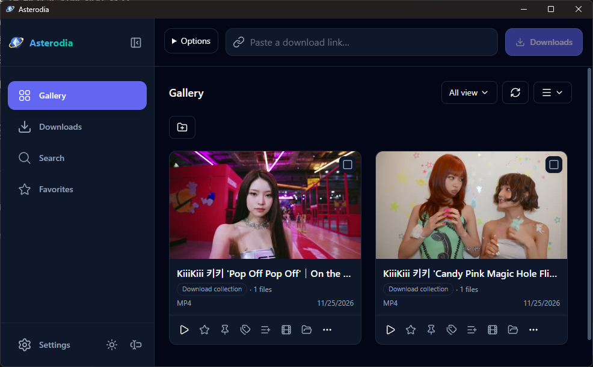
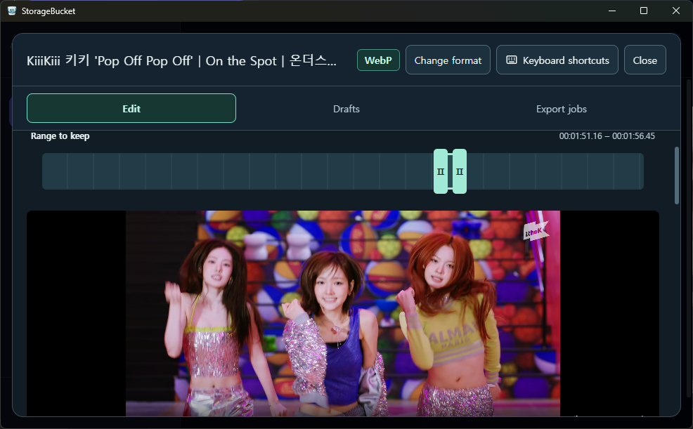
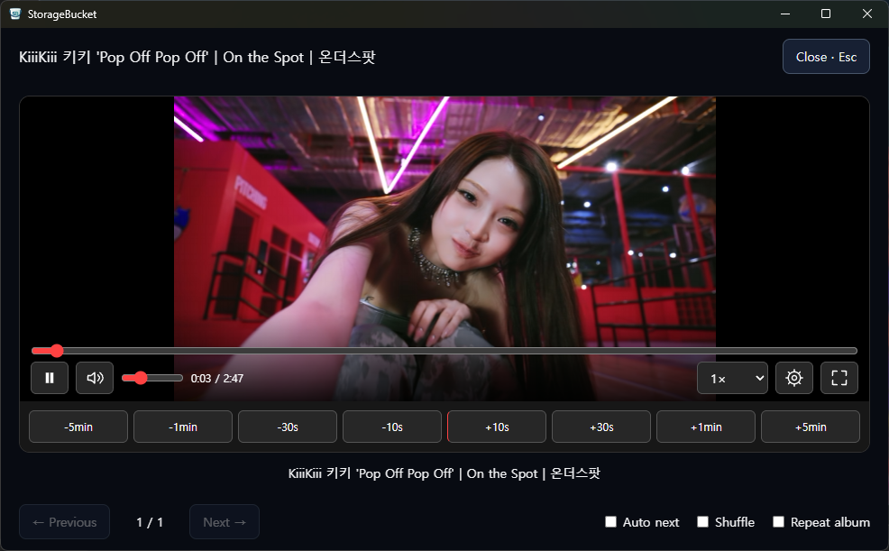

# Asterodia

기존 라이브러리 데이터와 설정은 자동 이전하여 이어서 사용합니다.

미디어 다운로드부터 정리와 편집까지, 한곳에서.

Asterodia는 이미지·영상·오디오를 관리하기 위한 데스크톱 앱입니다.
지원되는 URL에서 미디어를 다운로드하거나 PC에 있는 파일을 등록하고,
태그와 즐겨찾기로 라이브러리를 정리할 수 있습니다.

[English](./README.md) | [한국어](./README.ko.md)

[다운로드](https://github.com/Dev-Wonjoon/Asterodia/releases) ·
[문제 신고](https://github.com/Dev-Wonjoon/Asterodia/issues)

## 스크린샷

### 갤러리와 다운로드 진행 상황



### WebP 편집



### 영상 재생



## 주요 기능

### 미디어 다운로드
- yt-dlp와 gallery-dl을 이용한 미디어 다운로드
- 다운로드 진행 상황 확인, 로그 조회, 실패한 작업 재시도
- HLS·DASH 스트리밍 다운로드
- 인증이 필요한 경우 브라우저 쿠키 또는 Netscape 형식의 쿠키 파일 설정

지원 사이트와 다운로드 가능한 형식은 외부 다운로드 엔진에 따라 달라집니다.
일부 사이트는 로그인이 필요하거나 다운로드가 제한될 수 있습니다.

### 라이브러리 관리
- 로컬 폴더와 하위 폴더의 이미지·영상·오디오 등록
- 태그와 즐겨찾기를 이용한 미디어 정리
- 제목·태그·작성자·플랫폼 검색 및 검색 자동완성
- 여러 게시글을 선택한 뒤 일괄 작업
- 등록된 폴더로 파일 이동
- 누락된 썸네일 자동 생성

폴더 가져오기는 기존 위치의 파일을 라이브러리에 등록하며,
원본 파일을 복사하거나 이동하지 않습니다.

### 사용자 앨범과 감상하기

- 갤러리의 `새 앨범`으로 앨범을 만들고, 선택한 앨범 전체나 개별 파일을 추가합니다.
- 사용자 앨범은 여러 폴더의 원본 파일을 참조합니다. 같은 파일을 여러 앨범에 추가할 수 있으며, 앨범에서 빼거나 앨범을 삭제해도 원본은 유지됩니다.
- `앨범 편집`에서 이름과 파일 순서를 변경합니다. 기본 순서는 추가한 순서이며 드래그와 위·아래 버튼을 지원합니다.
- `감상하기`는 이미지 뷰어, 기존 동영상 플레이어, 오디오 플레이어를 제공합니다. 방향키와 이전·다음 버튼으로 현재 앨범 안에서 이동하고 Esc로 닫습니다. 닫으면 재생이 정지하고 갤러리 위치는 유지됩니다.
- `자동 다음`, `셔플`, `앨범 반복`은 독립적인 옵션이며 기본은 모두 끄기입니다. 자동 다음은 동영상·오디오의 재생 종료에 적용하고 이미지는 수동으로 넘깁니다. 셔플은 한 바퀴 안에서 중복되지 않으며 반복할 때 새로 섞습니다.
- `한 폴더에 모으기`는 등록된 대상 폴더로 복사 또는 이동합니다. 기본은 복사이며 원본과 앨범의 참조를 유지합니다. 복사본을 갤러리에 등록하려면 대상 폴더를 다시 가져옵니다. 이동은 복사·검증 후 원본을 정리하고 모든 앨범이 같은 파일 ID로 새 위치를 참조합니다. 같은 이름은 번호를 붙여 보존합니다.
- DB 스키마 11은 사용자 앨범과 복사·이동 작업 방식을 저장합니다. 기존 Wails DB는 백업 후 자동으로 이관하며 Electron DB 지원 중단 정책은 유지됩니다.

### 미디어 편집
- 영상에서 GIF·애니메이션 WebP 제작
- 기존 GIF 편집
- 영상 구간 자르기와 음소거
- 구간 선택, 크롭, 프레임 제외, 출력 화질 미리보기
- 원본 파일을 보존하면서 편집 결과 저장

### 브라우저·모바일 접근
- 로컬 웹 서버를 통한 갤러리 탐색, 검색, 미디어 재생
- 별도로 설정한 Tailscale 연결을 통한 모바일 접근
- PC에서 모바일 편집을 허용한 경우 모바일에서 편집 작업 요청 및 상태 확인

이용 중에는 PC의 Asterodia가 실행 중이어야 합니다.
미디어 재생 가능 여부는 브라우저가 지원하는 형식에 따라 달라집니다.

## 시작하기

1. [릴리스 페이지](https://github.com/Dev-Wonjoon/Asterodia/releases)에서 배포 파일을 다운로드합니다.
2. Asterodia를 실행합니다.
3. 처음 실행할 때 표시되는 엔진 설정 안내에 따라 필요한 외부 도구를 설치합니다.
4. 설정에서 다운로드 경로를 지정합니다.
5. 미디어 URL을 추가하거나 로컬 폴더를 가져와 라이브러리를 구성합니다.

외부 도구는 설정 → 엔진 관리에서도 설치하거나 업데이트할 수 있습니다.

## 외부 도구

Asterodia는 미디어 다운로드, 정보 검사, 편집을 위해 다음 외부 도구를 사용합니다.

| 도구 | 용도 |
| --- | --- |
| yt-dlp | 영상·오디오 및 HLS·DASH 다운로드 |
| gallery-dl | 지원되는 갤러리·소셜 플랫폼의 미디어 다운로드 |
| FFmpeg | 미디어 편집·변환 및 영상 썸네일 추출 |
| FFprobe | 영상·오디오 정보 검사 |
| ImageMagick | 이미지 검사 및 미리보기 생성 |

외부 도구를 설치하거나 업데이트하려면 인터넷 연결이 필요합니다.

## 데이터베이스 가져오기

설정 → 일반 설정 → Wails 데이터베이스 가져오기에서
Asterodia Wails 데이터베이스를 현재 라이브러리에 병합할 수 있습니다.

## 브라우저·모바일에서 이용하기

설정 → 네트워크 설정에서 로컬 웹 서버를 시작한 다음,
표시되는 로컬 주소를 PC의 브라우저에서 엽니다.

모바일에서 접근하려면 로컬 서버에 연결할 수 있도록 Tailscale을 별도로 설정해야 합니다.
모바일에서 편집 작업을 요청하려면 PC에서 ‘모바일 편집 허용’을 켜 주세요.

로컬 웹 서버는 앱을 실행할 때 기본적으로 꺼져 있으며,
앱을 종료하면 서버도 종료됩니다.

브라우저에서 접속할 때 PC의 네트워크 설정에 표시되는 8자리 연결 코드를 입력합니다.
코드는 5분 동안 유효하며 사용할 때마다 바뀝니다. 연결은 최대 8시간 유지됩니다.
서버를 다시 시작하거나 **모든 연결 해제 및 코드 재발급**을 선택하면 기존 연결이 해제됩니다.

다운로드는 공개 인터넷의 HTTP/HTTPS 주소와 80/443 포트를 사용합니다.
로컬·내부망 주소와 지원하지 않는 전송 경로는 거부합니다.
실행 중인 작업 3건 외에 최대 20건까지 대기할 수 있습니다.
작업별 임시 파일 20 GiB와 디스크 여유 공간 5 GiB를 감시하며,
엔진 프로세스 그룹의 메모리는 2 GiB로 제한합니다. 자원 검사에 실패하면 작업을 중단합니다.

엔진 버전과 SHA-256은 앱 릴리스에 고정되며 실행 전에 검증합니다.
기존 엔진의 무결성 검증에 실패하면 설정 → 엔진 관리에서 다시 설치하세요.

## 개발

Asterodia 2.0은 Wails v3와 Go 기반 데스크톱 백엔드,
React·TypeScript 기반 UI, SQLite 기반 로컬 데이터 저장소로 구성되어 있습니다.

필요한 개발 환경:

- Go 1.26 이상
- Node.js 및 npm
- Wails v3 CLI 및 운영체제별 빌드 의존성

개발 모드 실행:

```sh
wails3 task dev
```

애플리케이션 빌드:

```sh
wails3 build
```

현재 애플리케이션 코드는 저장소 루트와 `frontend/`에 있습니다.
2.1.0부터 이전 Electron 구현과 Electron DB 변환 자료를 제거했습니다.
DB 테스트는 Electron DB 거부와 Wails DB의 업그레이드·가져오기·원본 보존을 검증합니다.

## Windows 릴리스 버전

2.2.6부터 Windows 배포와 자동 업데이트는 `major.minor.patch`, 소문자 수정 문자
하나(`2.2.6a`부터 `2.2.6z`), 숫자 수정 번호(`2.2.6.1`)를 지원합니다.
문자는 시험판이 아닌 정식 수정 버전입니다. 정렬 순서는
`2.2.6 < 2.2.6a < ... < 2.2.6z < 2.2.6.1 < 2.2.6.2 < 2.2.7`입니다.
기본 세 숫자는 각각 0–65535이고, 숫자 수정 번호는 앞자리 0 없이 1–2427입니다.

Windows 숫자 메타데이터의 네 번째 자리는 기본 버전이면 0, a–z이면 1–26,
숫자 수정 번호이면 `27 * 수정 번호`를 사용합니다. 예를 들어 `2.2.6a`는
`2.2.6.1`로, 릴리스 `2.2.6.1`은 `2.2.6.27`로 변환합니다. 표시 버전과 Git 태그는
원래 표기를 유지합니다. 배포 파일과 체크섬은 같은 태그에 함께 게시해야 합니다.
2.2.8은 세 자리 숫자 버전을 사용하므로 2.2.5와 2.2.6에서도 자동 업데이트로
인식할 수 있습니다. 2.2.8로 업데이트한 뒤에는 숫자 수정 번호와 소문자를
함께 붙인 버전도 자동 업데이트할 수 있습니다. 이 복합 표기는 2.2.7.2a부터
지원하며, 예를 들어 `2.2.7.2 < 2.2.7.2a < ... < 2.2.7.2z < 2.2.7.3` 순서입니다.

## 사용 책임

Asterodia는 사용자가 소유하거나 다운로드·관리할 권한을 가진
미디어를 위한 도구입니다.

사용자는 저작권법, 플랫폼 이용약관, 콘텐츠 라이선스를 준수해야 합니다.
본 프로젝트는 DRM 우회나 무단 재배포를 목적으로 하지 않습니다.

## 라이선스

Asterodia는 [MIT 라이선스](./LICENSE)를 따릅니다.

사용된 라이브러리와 외부 도구에는 각각의 라이선스가 적용됩니다.
[서드파티 고지](./THIRD_PARTY_LICENSES.md) 또는 앱 내 라이선스 안내에서
자세한 내용을 확인할 수 있습니다.
