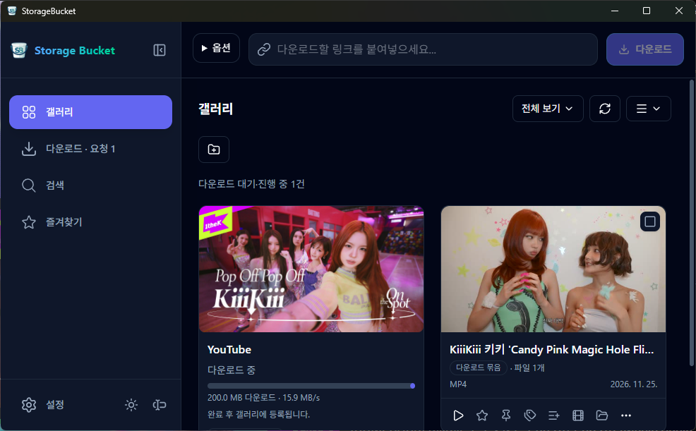
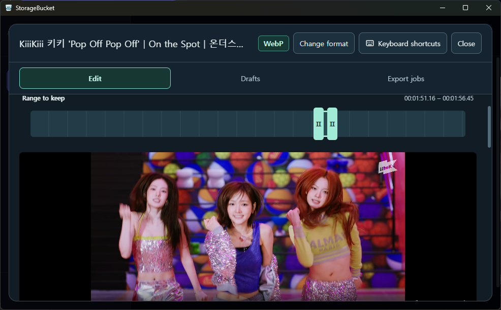
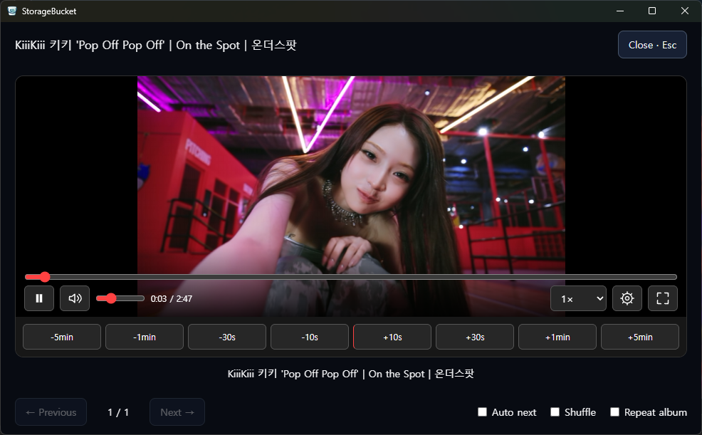

# StorageBucket

Download, organize, and edit your media in one place.

StorageBucket is a desktop application for managing images, videos,
and audio. Download media from supported URLs, register files already
on your PC, and organize your library with tags and favorites.

[English](./README.md) | [한국어](./README.ko.md)

[Downloads](https://github.com/Dev-Wonjoon/StorageBucket/releases) ·
[Report an Issue](https://github.com/Dev-Wonjoon/StorageBucket/issues)

## Screenshots

### Gallery and Download Progress



### WebP Editing



### Video Playback



## Features

### Download Media
- Download media using yt-dlp and gallery-dl.
- Track download progress, inspect logs, and retry failed tasks.
- Download HLS and DASH streams.
- Configure browser cookies or a Netscape-format cookie file when authentication is required.

Supported sites and available formats depend on the external download
engines. Some sources may require authentication or may be unavailable.

### Organize Your Library
- Register images, videos, and audio from local folders and subfolders.
- Organize media with tags and favorites.
- Search by title, tag, author, or platform, with search suggestions.
- Apply actions to multiple library entries at once.
- Move files to registered folders.
- Automatically generate missing thumbnails.

Local folder imports register files in their existing locations without
copying or moving the originals.

### User Albums and Media Viewing

- Create an album with **New album** in the gallery and add entire selected albums or individual files.
- User albums reference originals across folders. A file can belong to multiple albums; removing a membership or deleting an album keeps the originals.
- Use **Edit album** to change the name and file order. Files initially follow the order they were added; drag and up/down buttons are supported.
- **View** opens an image viewer, the shared video player, or an audio player. Arrow keys and previous/next buttons navigate within the album; Esc closes it, stops playback, and preserves the gallery position.
- **Auto next**, **Shuffle**, and **Repeat album** are independent options, all off by default. Auto next advances finished videos and audio; images remain manual. Shuffle avoids duplicate items within a cycle and reshuffles for repeat.
- **Collect in one folder** copies or moves files to a registered destination folder. Copy is the default and preserves original references; rescan the destination to register copies. Moves verify the copy before cleaning the source and retain file IDs across all albums. Filename collisions receive a numeric suffix.
- Schema 11 adds user albums and durable copy/move modes. Existing Wails databases migrate after a backup; Electron databases remain unsupported.

### Edit Media
- Create GIFs and animated WebP images from videos.
- Edit existing GIFs.
- Trim video clips and remove audio.
- Select ranges, crop, exclude frames, and preview output quality.
- Save edited results while preserving the original files.

### Browser and Mobile Access
- Browse, search, and play media through the local web server.
- Access your library from mobile devices through a separately configured Tailscale connection.
- Submit and monitor editing jobs from mobile when mobile editing is enabled on the PC.

The desktop app must remain running. Media playback depends on the
formats supported by your browser.

## Getting Started

1. Download a release from the [Releases page](https://github.com/Dev-Wonjoon/StorageBucket/releases).
2. Launch StorageBucket.
3. Follow the engine setup prompt to install the required external tools.
4. Choose a download folder in Settings.
5. Add a media URL or import a local folder to start building your library.

External tools can also be installed or updated from Settings → Engine Management.

## External Tools

StorageBucket uses external tools for downloading, inspecting, and processing media.

| Tool | Purpose |
| --- | --- |
| yt-dlp | Video and audio downloads, including HLS and DASH |
| gallery-dl | Media downloads from supported galleries and social platforms |
| FFmpeg | Media processing, conversion, and video thumbnail extraction |
| FFprobe | Video and audio metadata inspection |
| ImageMagick | Image validation and previews |

Installing or updating these tools requires an internet connection.

## Importing a Database

Use Settings → General Settings → Import Wails Database to merge a
StorageBucket Wails database into your current library.

## Browser and Mobile Access

Start the local web server from Settings → Network Settings and open
the displayed local address in a browser on your PC.

For mobile access, configure Tailscale access to the local server separately.
Enable “Allow Mobile Editing” on the PC if you want to submit editing jobs
from a mobile device.

The server starts disabled each time the app launches and stops when
the app closes.

Enter the eight-digit connection code shown in the PC's Network Settings to
connect a browser. Codes expire after five minutes and change after each use.
Sessions last up to eight hours. Restarting the server or choosing
**Disconnect all devices and renew code** revokes existing sessions.

Downloads use public HTTP/HTTPS destinations on ports 80/443. Local/private
network destinations and unsupported transfer paths are rejected. Up to 20
downloads may wait in addition to three running jobs. Each job is monitored
against a 20 GiB staging limit and a 5 GiB free-space reserve; engine process
groups have a 2 GiB memory limit. Jobs stop when resource checks fail.

Engine versions and SHA-256 digests are pinned to the app release and verified
before execution. If an existing engine fails integrity verification, reinstall
it from Settings → Engine Management.

## Development

StorageBucket 2.0 uses Wails v3 and Go for the desktop backend,
React and TypeScript for the interface, and SQLite for local data storage.

Prerequisites:
- Go 1.26 or later
- Node.js and npm
- Wails v3 CLI and its platform build dependencies

Run in development mode:

```sh
wails3 task dev
```

Build the application:

```sh
wails3 build
```

The current application lives in the repository root and `frontend/`.
The archived Electron implementation and its database conversion assets have
been removed starting with 2.1.0. Database tests cover rejection of Electron
databases, Wails database upgrades and imports, and preservation of source data.

## Windows release versions

Starting with 2.2.6, Windows releases and automatic updates accept `major.minor.patch`,
one lowercase fix letter (`2.2.6a` through `2.2.6z`), or a numeric fix (`2.2.6.1`).
Letters represent stable fixes, not prereleases. The order is
`2.2.6 < 2.2.6a < ... < 2.2.6z < 2.2.6.1 < 2.2.6.2 < 2.2.7`.
Each base component is 0–65535; numeric fixes are 1–2427, without leading zeros.
Starting with 2.2.7.2a, a numeric fix may also carry one lowercase letter:
`2.2.7.2 < 2.2.7.2a < ... < 2.2.7.2z < 2.2.7.3`.

Windows numeric metadata uses a fourth component of 0 for the base release,
1–26 for a–z, and `27 * fix` for numeric fixes. For example, `2.2.6a` maps to
`2.2.6.1`, and release `2.2.6.1` maps to `2.2.6.27`. Displayed versions and Git tags
retain the original spelling. All release assets and checksums must use the same tag.
Release 2.2.8 uses a three-component version so 2.2.5 and 2.2.6 clients can
recognize it through automatic updates. After installing 2.2.8, clients can
also recognize combined numeric and letter fixes.
Combined numeric and letter fixes add the letter offset to `27 * fix`, so
`2.2.7.2a` maps to `2.2.7.55`. The final component must not exceed 65535
(fix 2427 supports only a–f). Versions through 2.2.7.2 cannot recognize this
combined format; download and replace the executable manually once to install
2.2.7.2a, or update to the compatible 2.2.8 release, to enable future combined-format updates.

## Responsible Use

Use StorageBucket only with media you own or have permission to download
and manage. You are responsible for complying with copyright laws,
platform terms, and content licenses.

StorageBucket is not intended for DRM circumvention or unauthorized redistribution.

## License

StorageBucket is licensed under the [MIT License](./LICENSE).

Third-party libraries and external tools are covered by their respective
licenses. See [Third-Party Notices](./THIRD_PARTY_LICENSES.md) or view the
license notices in the app.
